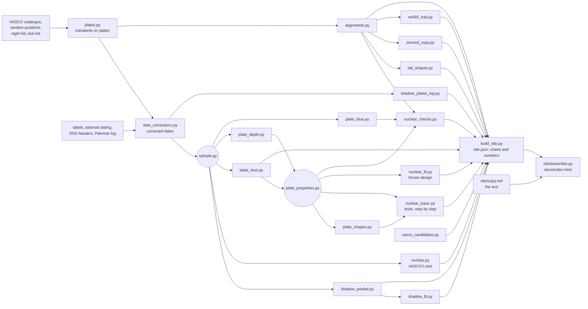

# POSS-I transients re-examined

A re-examination of three statistical claims made by the VASCO project about transients on the red plates of the first
Palomar Sky Survey (1949–1957): fewer transients inside Earth's shadow, more transients near US nuclear tests, and
transients lying in straight lines. Also a correction to the archive dates of the plates.

The page is `docs/index.html`. Every chart and every number in its text comes from the pipeline below.

## Running it

```
python -m venv .venv && source .venv/bin/activate
pip install .                # the pinned versions the page was built with
make                         # builds everything that is out of date
```

`make -n` shows what would run, `make help` lists the stages. A full run from scratch downloads VASCO's public data,
DSS cutouts from STScI and SuperCOSMOS scans, and runs the alignment search over 1,000 shifted copies of the catalogue,
which is the slow step.

## The pipeline



Each box is one script in `analysis/`, run as `python analysis/<script>.py`, with its method, inputs and outputs in its
docstring. `build_site.py` gathers every result into `docs/data/site.json`: the data for each chart, and a table of
numbers. The text in `site/copy.md` quotes numbers as `{n:key}`, and `site/assemble.py` fills them from that table; a
key with no value stops the build. The text cannot quote a number the pipeline did not produce.

`site/edit.py` serves the page locally for editing the text and leaving comments (`python site/edit.py`).

## Samples

Two samples, defined once in `analysis/sample.py`:

- **ours**, for every result on the page: all 635 plates in the catalogue and all 107,875 transients, each plate on its
  corrected date. Observing nights are Palomar's log nights (VizieR VI/25), dated by UT (evening date + 1).
- **vasco**: VASCO's own construction, used only to reproduce their numbers: the 561 plates whose archive date is on
  their list of 370 nights, on archive dates. Quoted for the Earth's-shadow count with archive dates and for their
  nuclear-test result (26 nights).

## Inputs

Downloaded when missing (not in the repository): VASCO's catalogue, random positions, night list and test list
(`fetch_external.py`); Palomar's log (`fetch_palomar_log.py`); DSS scans and cutouts, which STScI does not allow to be
redistributed. `tail_shapes.py` keeps its fits to the stars beside each cutout, and `plate_shapes.py` the transients it has measured, so reruns skip them.

In the repository, because they were made by hand or take hours of calls to public services:

| File | What | Remade by |
|---|---|---|
| `data/label_readings.csv`, `data/extra_labels.csv` | dates read by eye off the plate labels | reading the crops from `fetch_labels.py` |
| `data/date_check_summary.csv` | asteroid trails dating each plate | `date_check.py` (JPL Horizons, SkyBoT) |
| `data/xe_headers.parquet`, `data/xe_plate_centres.csv` | DSS header facts for every red plate | `plate_headers.py` |
| `data/plate_dust.csv` | dust towards each plate | `plate_dust.py` (IRSA), run by `make` for new plates only |
| `data/plate_depth.csv`, `data/plate_blue.csv`, `data/plate_shapes.csv` | stars and specks measured on DSS cutouts: each plate's depth and sharpness, specks on the red and blue plates, transient shapes | `plate_depth.py`, `plate_blue.py`, `plate_shapes.py` (DSS), run by `make` when their inputs change |
| `data/vasco_2025_candidates.csv` | VASCO's five shortlisted alignments | from the tables in their 2025 paper |

## Choices worth knowing

- **Plate area for Earth's shadow.** Each plate is its central 6 × 6 degrees, the plate size VASCO use, which their
  random positions cover evenly. The pooled count and the plate-by-plate fit use the same square.
- **Density across a plate.** Transients are two to three times denser at plate edges and corners. In the
  plate-by-plate fit, each part of a plate is weighted by the average density of transients there, measured on plates
  the shadow never crossed, so the weights cannot absorb a real shortfall in the shadow. Injected shortfalls are
  recovered (`shadow_fit.py`).
- **Calibration by real plates.** Counting statistics treat transients as independent; they are not. Every
  significance on the page comes from the real data: shadow outlines laid on other plates, nights drawn at random,
  and copies of the catalogue with real lines broken but the clumps kept.
- **Nuclear tests: design fixed in advance.** The within-run comparison, its nulls, and its checks were written down in
  `analysis/NUCLEAR_DESIGN.md` before the results were seen; every later test is a dated addendum there, also written
  before it was run.
