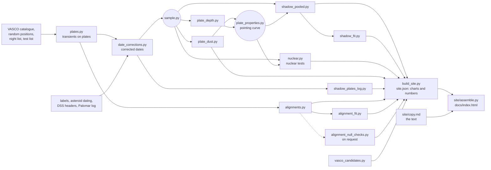

# POSS-I transients re-examined

A re-examination of three statistical claims made by the VASCO project about transients on the red plates of the first
Palomar Sky Survey (1949–1957): fewer transients inside Earth's shadow, more transients near US nuclear tests, and
transients lying in straight lines. Also a correction to the archive dates of the plates.

**The page: https://donalhill.github.io/poss-transients/** (built into `docs/index.html`). Every chart and every number
in its text comes from the pipeline below.

## Running it

```
python -m venv .venv && source .venv/bin/activate
pip install .                # the pinned versions the page was built with
make                         # builds everything that is out of date
```

`make -n` shows what would run, and `make help` lists the stages. A full run from scratch downloads VASCO's public
data, DSS cutouts from STScI, and SuperCOSMOS scans, and runs the alignment search over 1,000 shifted copies of the
catalogue, which is the slow step.

## The pipeline



Each box is one script in `analysis/`, run as `python analysis/<script>.py`, with its method, inputs, and outputs in its
docstring. `build_site.py` gathers every result into `docs/data/site.json`: the data for each chart, and a table of
numbers. The text in `site/copy.md` quotes numbers as `{n:key}`, and `site/assemble.py` fills them from that table; a
key with no value stops the build, so the text cannot quote a number the pipeline did not produce.

`python site/edit.py` serves the page locally for editing the text and leaving comments.

## Samples

Two samples, defined once in `analysis/sample.py`:

- **ours**, for every result on the page: all 635 plates in the catalogue and all 107,875 transients, each plate on its
  corrected date and at its mid-exposure time: the header's time is the exposure's start in hours and hundredths of an
  hour (06:82 is 06:49), which VASCO's `UTobservation` reads as hours and minutes. Observing nights are Palomar's log
  nights (VizieR VI/25), dated by UT (evening date + 1).
- **vasco**: VASCO's own construction, used only to reproduce their numbers: the 561 plates whose archive date is on
  their list of 370 nights, on archive dates.

## Inputs

Downloaded when missing, and not kept here: VASCO's catalogue, random positions, night list, and test list
(`fetch_external.py`), and DSS scans and cutouts, which STScI does not allow to be redistributed.

Kept in the repository, because they were made by hand or take hours of calls to public services:

| File | What | Made by |
|---|---|---|
| `data/label_readings.csv`, `data/extra_labels.csv` | dates read off the plate labels: 15 checked by eye, including both that overrule the log; the other 40 all agree with Palomar's log | reading the crops from `fetch_labels.py` |
| `data/date_check_summary.csv` | asteroid trails dating each plate, on two groups of plates (near the shadow; at random near the ecliptic); each plate's day set by `date_check.resolve`, which `date_corrections.py` checks on every row | `date_check.py` (JPL Horizons, SkyBoT) |
| `data/xe_headers.parquet`, `data/xe_plate_centres.csv` | DSS header facts for every red plate | `plate_headers.py` |
| `data/palomar_log_vi25.csv` | Palomar's observing log | `fetch_palomar_log.py` (VizieR VI/25) |
| `data/plate_dust.csv` | dust towards each plate | `plate_dust.py` (IRSA), run by `make` for new plates only |
| `data/plate_depth.csv` | each plate's depth and sharpness, measured on Gaia stars in DSS cutouts | `plate_depth.py`, run by `make` when its inputs change |
| `data/us_shot_times.csv` | the time of each US shot, by test series, including the eleven of Operation Upshot-Knothole (1953) missing from VASCO's list | compiled from DOE/NV-209, with a source for each row |
| `data/shadow_null_checks.json` | the pooled shadow null checked: calibration on plates the shadow never crossed, no leak, injected shortfalls recovered, and the pointing curve term by term | `shadow_null_checks.py` (`make shadow-checks`) |
| `data/alignment_null_checks.json` | the alignment null made other ways, as a check on it | `alignment_null_checks.py` (`make null-checks`), which repeats the slow search |
| `data/vasco_2025_candidates.csv` | VASCO's five shortlisted alignments | from the tables in their 2025 paper |

## Choices worth knowing

- **Plate area for Earth's shadow.** Each plate is its central 6 × 6 degrees, the plate size VASCO use, which their
  random positions cover evenly. The pooled count and the plate-by-plate fit use the same square.
- **Density across a plate.** Transients are two to three times denser at plate edges and corners. In the
  plate-by-plate fit, each part of a plate is weighted by the average density of transients there, measured on plates
  the shadow never crossed, so the weights cannot absorb a real shortfall in the shadow. Injected shortfalls are
  recovered (`shadow_fit.py`).
- **Pointing.** Plates differ in how many transients they hold depending on where the telescope pointed: distance
  from the Milky Way, dust, and distance from the ecliptic; and the row of plates centred on the celestial equator holds
  about a third as many as the rest, already so in Solano et al.'s published list (on the same sky, about two-fifths as
  many as the row to its north), so the curve has a term for it. One curve (`plate_properties.pointing`) gives every plate
  an expected count. The pooled shadow test scales each random placement to the shadow plate's pointing, with the curve
  fitted without the plates the shadow crosses; the nuclear test measures plates against it, also refitted without the
  plates near tests. `shadow_null_checks.py` checks the scaled shadow null gives the right share of
  low results on plates the shadow never crossed, and recovers injected shortfalls.
- **Calibration by the real data.** Counting statistics treat transients as independent; they are not. Every
  significance on the page comes from the real data: shadow outlines laid on other plates, the test calendar shifted
  to other years, and copies of the catalogue with real lines broken but the clumps kept.
- **Alignments.** A track counts its transients in 20″ boxes along it (Lezama et al. 2015), so a close pair counts
  once. The copies move each clump of transients (within 20″ of one another) as one piece and keep exactly the real
  clumps; a track holding three or more transients from one clump is left out, in the data and the copies alike.
  `alignment_null_checks.py` checks that the copies keep the real pair counts, break strong added tracks (each
  transient moves far less than a track is long, so weak fragments of a track survive in the copies), and give the same
  answer when made other ways, including with no clumps kept. `alignment_fit.py` fits the four
  score distributions with the random catalogues as background and artificial glint tracks of 3, 4, 5, and 6 flashes as
  signal (each glint's candidates of every size kept together), and sets a 95% limit on the number of each from toys,
  each toy's background carrying what copies keep of its own tracks (checked band by band against the copies of the
  catalogue holding 100 added tracks; at the weakest scores it allows for about a quarter more than measured, which
  loosens the limits); and again with glints scattered by 2″, not 1″.
- **Nuclear tests.** The full list of US tests (DOE/NV-209; VASCO's list lacks Operation Upshot-Knothole), and VASCO's
  window, a night within a day of a test by local evening date. Transients are counted per photograph and measured
  against what each plate's pointing predicts. The test calendar is shifted by 1 to 5 years and up to two months,
  keeping each test's time of year and the gaps between tests; plates from the two weeks around real tests are left out
  of every shifted calendar, and only calendars holding within 30% as many plates as the real one are kept.
